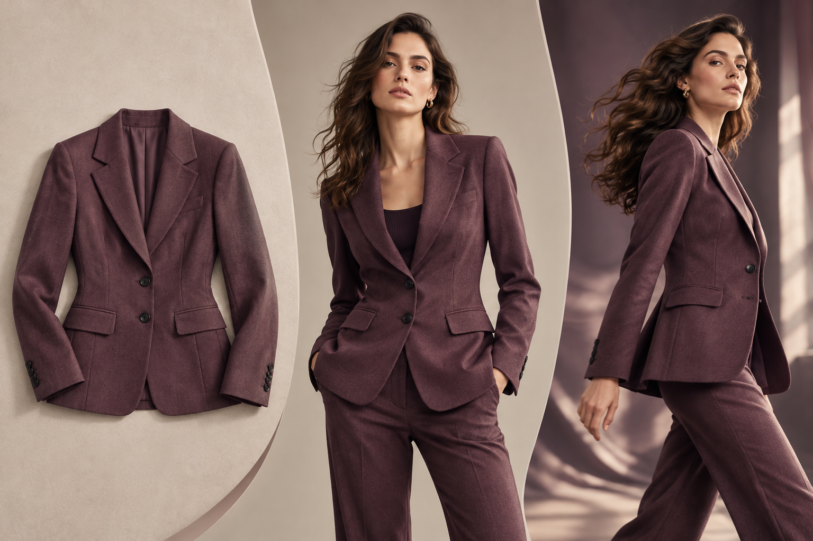

# Dari Satu Foto Busana ke Konten Siap Terbit: Alur Kerja AI dalam Enam Langkah

> Artikel panjang · panduan praktis

## Bangun alur kerja sebelum mengejar visual yang spektakuler

Konten fesyen AI tidak dimulai dari prompt yang panjang. Pertama, pastikan referensi produk nyata yang tersedia, tempat konten akan digunakan, dan detail pakaian yang tidak boleh berubah. Tim mungkin membutuhkan foto halaman produk, video media sosial, materi peluncuran, dan konsep iklan; setiap kebutuhan memiliki rasio, latar, gerak, dan standar pemeriksaan berbeda. Pecah tujuan terlebih dahulu agar AI memperluas kapasitas produksi, bukan menambah putaran revisi.

## Langkah 1: jadikan foto sumber sebagai referensi yang dapat diperiksa

Jika memungkinkan, siapkan tampak depan, belakang, samping, dan detail. Pakaian sebaiknya rata, terkena cahaya merata, tanpa pantulan atau bagian yang tertutup. Pastikan kerah, manset, garis pinggang, kelim, dan tepi motif terlihat. Tambahkan foto dekat untuk bahan atau hiasan yang rumit. Kendalikan pantulan pada kain gelap dan pertahankan gradasi kain putih. Jika foto sumber tidak menunjukkan belahan belakang, kancing tersembunyi, atau konstruksi saku, model tidak dapat memulihkan fakta tersebut secara andal.

Sebelum membuat visual, tulis daftar “jangan diubah”: kelompok warna, siluet, panjang lengan dan pakaian, posisi motif, jumlah kancing, tekstur kain, serta hiasan yang tidak dimiliki produk. Minta penanggung jawab produk mengonfirmasi lalu bagikan kepada kreator. Daftar ini tidak menghilangkan semua kesalahan; fungsinya menentukan titik pemeriksaan dan perbedaan yang membuat aset harus ditolak.

## Langkah 2: setujui gambar diam sebelum membuat gerak

Buat gambar statis saat busana dikenakan model, lalu bandingkan dengan referensi. Apakah jahitan bahu bergeser, pinggang naik, rok memendek, motif berubah, atau kancing dan saku bertambah atau hilang? Bentuk tubuh dan pose memengaruhi kesan jatuhnya kain, jadi gambar generatif bukan pengganti tabel ukuran atau hasil uji pakai. Halaman produk tetap harus memuat ukuran, komposisi bahan, dan petunjuk perawatan yang benar.

Setelah gambar lolos, tambahkan satu gerak ringan: berputar perlahan, melangkah sekali, mengangkat lengan sedikit, atau dorongan kamera halus. Setiap klip sebaiknya memiliki satu gerak utama dan mempertahankan latar, cahaya, serta struktur pakaian. Gerakan kompleks meningkatkan risiko kelim, manset, kancing, dan motif bergeser. Untuk perdagangan, cuplikan yang memperlihatkan bahan sering lebih mudah diverifikasi daripada putaran cepat atau tarian.

## Langkah 3: uji satu SKU di Visnova

Beranda Visnova menampilkan alur yang berfokus pada busana: mulai dari foto flat-lay, gantungan, atau manekin, pilih model dan arah gerak, lalu buat visual fesyen. Beranda juga menyebut pembuatan satu produk dengan cepat serta alur batch berbasis node. Mulailah dengan satu SKU: buka [Visnova](https://visnova.ai/), unggah foto produk yang jelas, pilih model dewasa dan latar sederhana yang sesuai merek, lalu tinjau gambar diam sebelum mencoba klip pendek. Nama menu, spesifikasi hasil, dan hak dalam paket dapat berubah; ikuti antarmuka yang tersedia pada akunmu.

Ubah satu variabel per percobaan—model, latar, atau gerak—dan catat sumber, prompt, versi keluaran, serta keputusan pemeriksaan per SKU. Minta rekan lain menilai detail busana secara mandiri agar kreator tidak hanya melihat hasil yang diharapkan.

## Langkah 4: tinjau oleh manusia dan edit untuk tiap kanal

Setelah pemeriksaan pertama, potong sesuai kanal dan perhatikan area aman teks. Pada video vertikal, pastikan antarmuka platform tidak menutupi kelim atau sepatu. Pada halaman produk horizontal, busana harus cukup besar untuk diperiksa. Tinjau bingkai demi bingkai untuk menemukan warna yang berkedip, tekstur yang berubah, tangan yang menutup detail, atau wajah yang berganti. Jika ada masalah, kurangi gerak, perbaiki referensi, atau buat ulang gambar diam; jangan memakai filter untuk menyamarkan kesalahan produk.

Beri label “disetujui”, “hanya konsep”, atau “buat ulang”. Simpan foto asli, versi generatif, prompt, pemeriksa, tanggal, dan kanal bersama-sama. Cara ini membuat alasan publikasi dapat dilacak dan materi lama dapat diturunkan saat produk berubah.

## Penutup: ukur kemampuan mengulang proses

Uji satu SKU, satu warna, dan satu kanal. Catat tingkat kelulusan, jumlah revisi, waktu dari unggah sampai disetujui, dan menit kerja manusia per aset yang lolos. Perluas hanya setelah detail pakaian stabil, tim mampu mengulang proses, dan hak penggunaan komersial telah diperiksa. AI memperluas pilihan visual dan mempersingkat sebagian langkah; fakta produk tetap memerlukan referensi yang benar dan pemeriksaan manusia.

Coba alurnya melalui [Visnova](https://visnova.ai/) atau kunjungi [situs Visnova berbahasa Mandarin](https://visnova-ai.cn). Uji detail, proses, dan ketentuan penggunaan dengan produkmu sendiri sebelum memasukkan hasil ke produksi.

