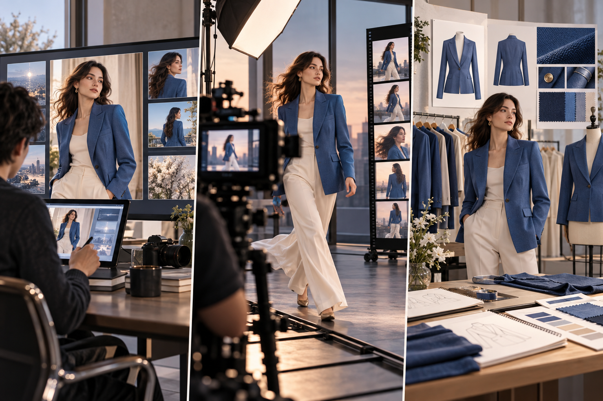
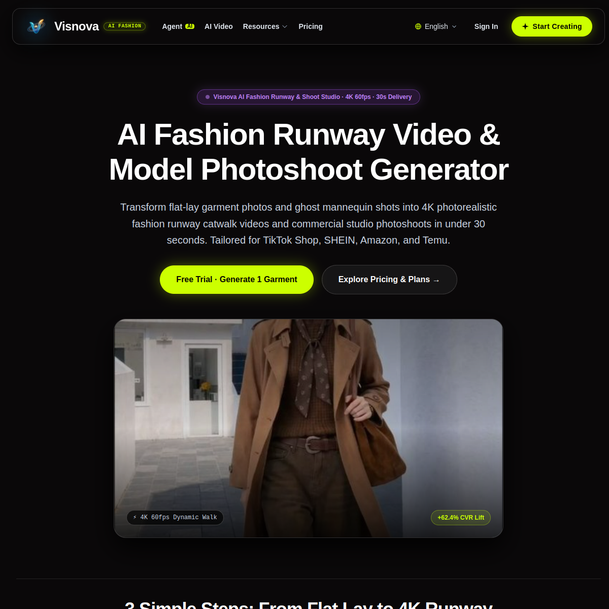
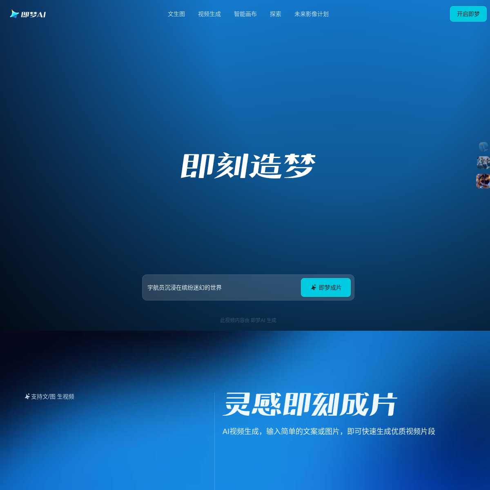
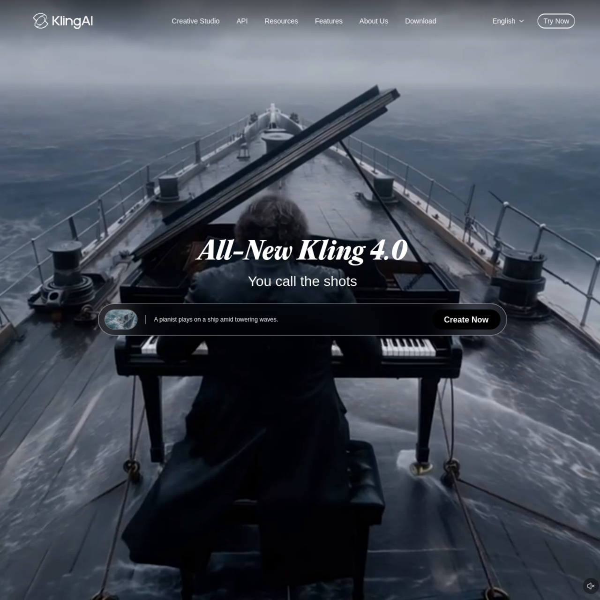
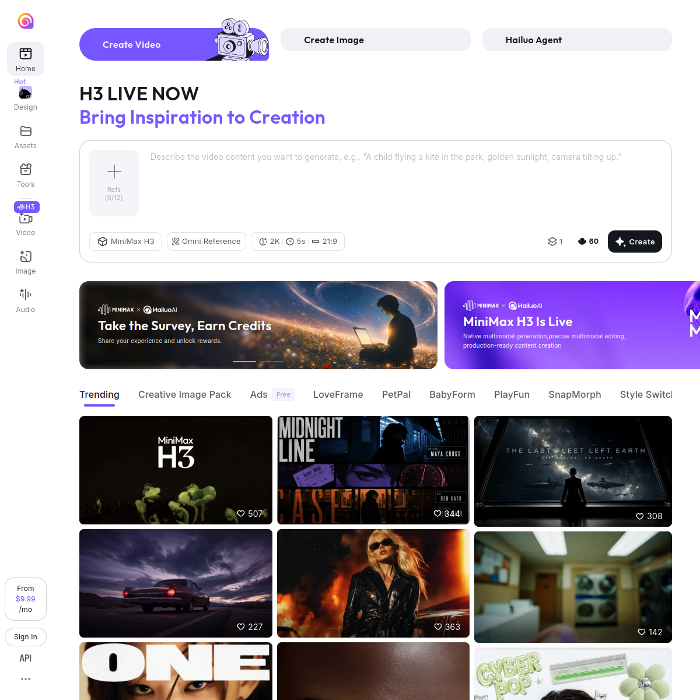

# Jimeng, Kling, MiniMax o Visnova? Come confrontare gli strumenti IA per la moda

> Articolo lungo · indagine competitiva e confronto pratico

## Distinguere «bello da vedere» da «fedele al prodotto»

Le demo video con IA spesso puntano sul movimento spettacolare. Nell’e-commerce moda bisogna controllare altro: colore, scollo, manica, posizione della stampa e silhouette corrispondono ancora al capo reale? Orlo e motivo si spostano quando l’immagine diventa un video? Uno strumento adatto a un film concettuale non è per forza ideale per produrre molte immagini prodotto. Questo articolo esamina le funzioni dichiarate nelle pagine ufficiali e gli screenshot delle homepage conservati qui; non è un benchmark indipendente e non assegna un primato di fedeltà.

## Cosa mostrano pubblicamente i prodotti

**Jimeng** presenta video da testo o immagine, frame iniziale e finale, prompt in cinese e una tela intelligente con modifica locale, espansione, cancellazione e ritaglio. Può essere candidato per esplorare idee in cinese, cambiare scenario e combinare immagini. Va verificato che bottoni, posizione della stampa e trama restino corretti. Vedi [Jimeng](https://jimeng.jianying.com/).

**Kling** mostra sulla homepage globale accessi a immagine, video, creatività, short e generazione; l’offerta evolve. Un team moda può provarlo per movimento del capo, atmosfera della camera e animazione da reference. La domanda giusta non è se un singolo esempio sembri cinematografico, ma se scollo, tasche, lunghezza e colore restano stabili in più generazioni dello stesso SKU. [Kling AI](https://app.klingai.com/global/).

**MiniMax Hailuo** offre percorsi testo-video e immagine-video. La guida immagine-video invita a caricare un’immagine e descrivere il movimento desiderato; camera, azione, sfondo e atmosfera sono indicati come elementi utili del prompt. Modelli, formati e diritti commerciali dipendono dall’account e dai termini aggiornati. Può animare una fotografia approvata, ma il movimento non prova la fedeltà del capo. Vedi [Hailuo image-to-video](https://hailuoai.video/tools/image-to-video).

**Visnova** presenta un flusso dedicato all’abbigliamento: partire da una foto piatta, appesa o su manichino, scegliere modella e movimento e creare visual di moda. La homepage descrive anche la creazione rapida di un singolo articolo e flussi a nodi per i lotti. È il posizionamento dichiarato, da verificare con SKU reali. [Visnova](https://visnova.ai/).

## Gli screenshot mostrano il posizionamento, non un punteggio

Queste immagini registrano gli ingressi e le descrizioni visibili sulle homepage ufficiali al momento della cattura. Non mostrano lo stesso abito generato da tutti e quattro i prodotti e non dimostrano prezzo, attesa, coerenza o diritti commerciali. Ricontrolla i siti aggiornati prima di acquistare o pubblicare.

### Visnova

### Jimeng

### Kling

### MiniMax Hailuo

## Confrontare in modo equo con lo stesso capo

Scegli un capo con costruzione chiara e colore stabile; fotografa davanti, dietro e un dettaglio del tessuto. Dai a tutti lo stesso obiettivo: «Mantieni scollo, manica, vita, colore e posizione della stampa. Una modella adulta fa un giro lento in uno studio semplice; camera fissa». Rispetta gli ingressi di ciascun prodotto: prompt cinese e frame iniziale/finale in Jimeng; animazione delicata della stessa immagine in Kling e Hailuo; flusso moda da prodotto a modella in Visnova. Non dare a un concorrente una reference migliore degli altri.

Genera tre risultati per strumento. Due revisori valutano la stessa griglia: colore e silhouette, dettagli costruttivi, continuità della stampa, stabilità nel tempo, minuti di ritocco, formati utili, costo effettivo, condizioni e diritti. Definisci prima i motivi di esclusione, come la scomparsa di un dettaglio essenziale o l’invenzione di un ornamento. Includi il ritocco manuale nel costo.

## Tutorial Visnova: iniziare dall’immagine statica

Apri [Visnova](https://visnova.ai/), scegli uno SKU con scheda completa e carica una foto nitida piatta, su gruccia o manichino. Scegli una modella adulta e uno sfondo sobrio coerente con il brand. Genera un’immagine statica e ingrandisci scollo, polsini, vita, bottoni, stampa e contorno. Se non passa, migliora la reference o rigenera; non moltiplicare un errore in un lotto. Dopo l’approvazione, aggiungi un movimento e controlla i frame per eventuali spostamenti di orlo o stampa. Interfaccia, formati e diritti possono cambiare: segui il tuo account attuale.

Per mood e styling concettuale o scene in cinese, Jimeng, Kling e Hailuo possono entrare nella rosa. Se il lavoro principale è rendere SKU reali in immagini di prodotto replicabili, confronta Visnova e gli strumenti moda con lo stesso capo. Prova prima, scegli in base alle prove.

## Fonti e prossimo passo

Le pagine ufficiali mostrano le funzioni annunciate; prezzo, tasso di successo, uso commerciale e dati vanno verificati a parte. Prova il flusso moda su [Visnova](https://visnova.ai/) o visita [il sito cinese di Visnova](https://visnova-ai.cn).
