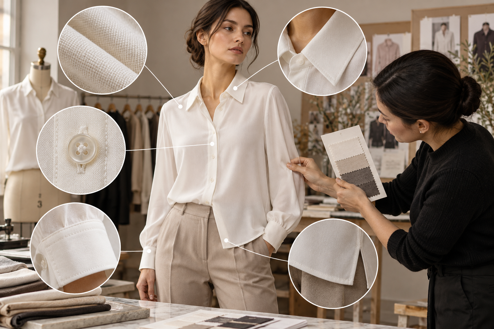

# Farbe, Passform, Muster und Bewegung: Qualitätskontrolle für KI-Fashion

> Langform-Blog · praktische Qualitätskontrolle

## Ein Produkt nicht freigeben, nur weil das Bild „gut aussieht“

Kleidungsfidelität ist keine einzelne Bildnote. Ähnliche Farbe beweist nicht, dass Ausschnitt, Nähte, Taille, Länge, Taschen und Knöpfe stimmen. Ein freigegebenes Standbild garantiert auch keine stabilen Videoframes. Prüfe vier Stufen – Referenz, Standbild, Bewegung und Veröffentlichung – und lege Ausschlussfehler vor der Generierung fest. So bleiben Produktangaben verlässlich, während kreative Varianten möglich sind.

## Stufe 1: Referenz vor dem Prompt prüfen

Kontrolliere, ob das Kleidungsstück vollständig, scharf und gleichmäßig beleuchtet zu sehen ist. Haare, Hände, Schmuck und Falten dürfen die Konstruktion nicht verdecken. Vergleiche die Farbe bei neutralem Licht mit einem Muster und ergänze Nahaufnahmen von Stoff, Besatz und Druck. Notiere SKU, Farbvariante, Größen, Material und unveränderliche Merkmale. Ein Modell kann eine nicht sichtbare Tasche oder einen Verschluss nicht zuverlässig ableiten. Fehlende Produktbelege sind ein Foto-Problem, das ein längerer Prompt nicht löst.

## Stufe 2: Standbild mit einer Konstruktionsliste abgleichen

Lege Ergebnis und Referenz nebeneinander. Prüfe nacheinander Silhouette und Proportionen, Schulter- und Taillennähte, Ausschnitt und Bündchen, Anzahl der Knöpfe und Taschen, Richtung und Position des Musters sowie Farbton und Kontrast. Natürliche Falten dürfen variieren, aber Nahtführung, Muster und Produktfarbe sollten nicht frei neu gestaltet werden. Zoome Achseln, überlappende Kanten, Hände und Saum heran: Dort entstehen oft Löcher, schmelzender Stoff und gebrochene Konturen. Ein schwerer Konstruktionsfehler bedeutet Ablehnung, auch wenn der Gesamteindruck überzeugt.

## Stufe 3: Bewegung über die Zeit kontrollieren

Sichere Frames von Anfang, Mitte, Ende und Posewechseln. Suche nach wandernden Mustern, flackernden Knöpfen, wechselnder Saumlänge, Ärmeln, die durch den Körper laufen, und Farbsprüngen. Starte mit fester Kamera, einfachem Hintergrund und wenig Bewegung. Karos, Streifen, Allover-Drucke, transparente Stoffe und Pailletten brauchen häufigere Kontrollen. Ein instabiles Detail gehört nicht in eine Nahaufnahme, die Produktkonstruktion erklären soll.

## Beobachtungen in eine Bewertungsmatrix übertragen

Das Team kann eine 100-Punkte-Vorlage testen: Farbe und Silhouette 25, Konstruktion 30, Muster und Textur 20, zeitliche Konsistenz 15, Zuschnitt für den Kanal 10. Kritische Konstruktionsfehler bleiben Ausschlussregeln, damit sie nicht im Durchschnitt verschwinden. Speichere abgelehnte Beispiele mit Fehleretiketten und vergleiche Passraten nach Warentyp, Referenzqualität und Bewegung. Die Gewichtung ist eine anpassbare Teamvorlage, kein Branchenstandard.

## Visnova-Anleitung: vom Original bis zur Freigabe dokumentieren

Erstelle in [Visnova](https://visnova.ai/) aus einem klaren Flatlay-, Hänge- oder Mannequinfoto zuerst ein statisches On-Model-Bild. Schreibe die zu erhaltenden Merkmale in Prompt und Prüfbogen und vergleiche Farbe, Länge, Nähte, Muster und Zubehör einzeln. Erst nach Freigabe kommt eine Bewegung hinzu. Exportiere den Clip und prüfe Frames erneut. Speichere pro SKU Quelle, Eingabenotiz, Version, Fehler, Prüfer und Entscheidung. Die Homepage zeigt einen Modeablauf; besonders dichte Muster und ungewöhnliche Stoffe müssen am echten Produkt geprüft werden.

**Fazit:** Qualitätskontrolle stoppt Kreativität nicht. Sie macht sichtbar, was ein veröffentlichtes Bild behauptet und wo seine Grenzen liegen. Definiere Produktbelege und erlaubte Abweichungen, bevor du Werkzeuge auswählst. Teste den Ablauf auf [Visnova](https://visnova.ai/) oder [der chinesischen Visnova-Seite](https://visnova-ai.cn).
