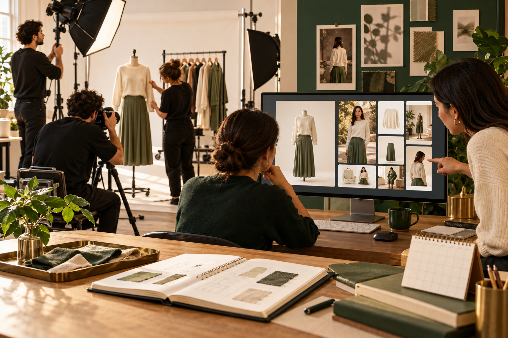

# تكلفة أزياء الذكاء الاصطناعي وعائد الاستثمار: احسب سير العمل كاملاً عبر تجربة SKU

> مقالة مطولة · دليل التكلفة والعائد

## اسأل أي عمل سيوفَّر، لا كم يكلف التوليد مرة واحدة فقط

عند مقارنة التصوير التقليدي بإنتاج الأزياء بالذكاء الاصطناعي، لا تمثل رسوم التوليد إلا بنداً واحداً. قد تشمل جلسة التصوير شحن العينات وأجر العارضة والمصور والاستوديو والإضاءة والتنسيق والتنقيح والسفر والجدولة وإعادة التصوير. ويضيف سير الذكاء الاصطناعي ترتيب الصور الأصلية وتجربة الموجّهات والمخرجات الفاشلة والإصلاح اليدوي والمراجعة والتحقق من الحقوق والاشتراك والتخزين والمونتاج. لا تصبح المقارنة مفيدة إلا إذا اتحدت المخرجات ومعايير الفحص.

## أنشئ نموذج تكلفة كاملة لكل SKU

سجّل لكل SKU رسوم التصوير أو الأداة، والرصيد المستهلك في كل محاولة، وعدد المحاولات، ونسبة النتائج الصالحة، ودقائق التنقيح والمراجعة والمونتاج، وجهد تنظيم الأصول، ومدة التسليم. يمكن استخدام الإطار التالي: تكلفة الأصل المعتمد = الرسوم المباشرة + تكلفة التوليد الفاشل + ساعات الإنتاج × التكلفة الداخلية للساعة + المراجعة والإدارة + الإنهاء. أدخل الرواتب والفواتير والعقود الفعلية. الأرصدة المجانية والسرعة المعلنة ليست تكلفة وحدة مثبتة.

افصل المهام القابلة للاستبدال عن المهام المتبقية. قد يساعد الذكاء الاصطناعي في تغيير الخلفية أو إضافة حركة خفيفة إلى صورة معتمدة أو إعداد قصّات للقنوات. لكنه لا يستبدل دائماً اعتماد بنية القطعة أو معلومات القماش الحقيقية أو اختبار المقاس أو التنسيق المعقد. قارن ما توفره من التصوير مع الزيادة في المراجعة والإصلاح.

## مثال يمكن إعادة حسابه لا وعد بالنتائج

تخيّل فريقاً ينتج صور إطلاق لعشرين SKU أسبوعياً. يستهلك المسار التقليدي ثلاثين ساعة للتصوير والإنهاء. في تجربة الذكاء الاصطناعي ينشئ الفريق أربع نسخ لكل SKU، ويستخدم اثنتين فقط، ثم يخصص ثماني عشرة ساعة إضافية للفحص والإصلاح. حتى لو انخفضت فاتورة الأداة، قد لا تنخفض تكلفة العمل الإجمالية. قد يظهر الوفر في الجولة التالية إذا ارتفعت نسبة الاستخدام وانخفض التصحيح. الأرقام توضيحية ولا تمثل سعر Visnova أو كفاءتها أو وعداً بالإيراد.

صيغة ROI مبسطة: (وفر متحقق + مساهمة تجارية إضافية مقاسة − تكاليف الذكاء الاصطناعي الإضافية) ÷ تكاليف الذكاء الاصطناعي الإضافية. إذا لم يُقَس أثر التحويل فلا تحتسب ارتفاع المبيعات. اعرض إنشاء المحتوى وتكلفة المراجعة وإعادة الاستخدام ونتائج النشر كلّاً على حدة.

## صمم تجربة تربط المخرجات بساعات العمل

اختر فئة واحدة ونسبة صورة واحدة وقناة واحدة. سجّل خط الأساس المعتاد، وتجهيز الصور، ومحاولات التوليد والمراجعة والإصلاح وموعد التسليم. استخدم صوراً متقاربة الجودة وقائمة الملابس نفسها والمراجعين أنفسهم للحد من التحيز. قِس التكلفة لكل أصل معتمد وعدد الأصول الصالحة لكل SKU وساعات الإصلاح والوقت حتى الموافقة وإعادة الاستخدام عبر القنوات. في مقارنة الأدوات أعط الجميع صورة المنتج نفسها وولّد أكثر من مرة واحتفظ بالنتائج المرفوضة.

## تطبيق Visnova: سجّل التكلفة الحقيقية لكل SKU

قبل فتح [Visnova](https://visnova.ai/)، حدّد صورة المنتج الحقيقية وهدف النشر. ارفع مرجعاً مسطحاً أو معلقاً أو على مانيكان واختبر صورة ثابتة على عارضة، ثم انتقل للفيديو بعد اجتياز فحص الملابس. سجّل عدد الصور المرجعية وتغييرات الموجّه وعدد النتائج ودقائق الفحص اليدوي ومحاولات الإصلاح والصيغ النهائية. إذا أردت الإنتاج الدفعي، ثبّت أولاً مسار قطعة واحدة ثم قيّم سير العمل بالعُقد الذي تعرضه الصفحة الرئيسية. تحقّق من الميزات والأرصدة والمخرجات والحقوق في الحساب والشروط الحالية.

استخدم السجل نفسه مع Jimeng وKling وMiniMax Hailuo وVisnova وغيرها. قارن التكلفة والسرعة والجودة لكل أصل نهائي قابل للاستخدام، لا عدد الأرصدة المجانية. اختبر الافتراضات بعدد قليل من منتجاتك عبر [Visnova](https://visnova.ai/) أو [موقع Visnova الصيني](https://visnova-ai.cn).
