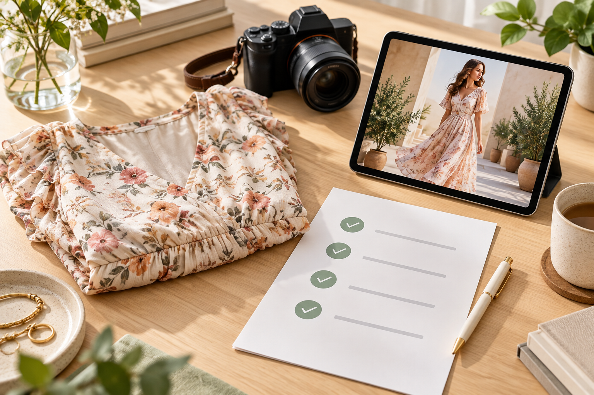

# Diritti, autorizzazioni ed etichettatura prima di pubblicare moda con IA

> Articolo lungo · diritti ed etichettatura

## «Si può generare» e «si può pubblicare» sono due domande diverse

Creare un’immagine di moda fotorealistica non attribuisce automaticamente tutti i diritti sulla foto del prodotto, la modella, il font, la musica, l’ambientazione o il risultato. Nel commercio contano anche le regole del marketplace, la veridicità delle descrizioni, l’etichettatura dei contenuti sintetici, le aspettative locali e i dati personali nelle immagini di riferimento. Questo articolo è una checklist operativa, non un parere legale. Per campagne internazionali, fai verificare le regole attuali di ogni mercato da un professionista.

## 1. Tracciare origine e permessi di ogni risorsa

Verifica chi detiene foto, logo, stampa, disegno del tessuto e packaging, e se la licenza consente di caricare materiale su un servizio IA di terzi. Se compare una modella reale, controlla che la liberatoria copra modifiche sintetiche, nuovi scenari, animazione, pubblicità, territori, durata e montaggi successivi. Il permesso per uno shooting classico non comprende necessariamente ogni adattamento IA. Preferisci foto proprietarie, liberatorie con ambito chiaro e musica, font e location regolarmente licenziati. Conserva contratti e approvazioni.

Non provare il virtual try-on con immagini web non autorizzate, foto di concorrenti, volti famosi o ritratti dei dipendenti. Il fatto che una piattaforma accetti il file non dimostra che la fonte sia legittima, che ci sia consenso o che il post rispetti le regole. Prima del caricamento oscura volti, indirizzi, numeri d’ordine e SKU interni non necessari. Leggi le regole correnti su privacy, conservazione e cancellazione.

## 2. Mantenere fedeli le affermazioni al capo reale

Colore, tessuto, trasparenza, taglio, taglia, accessori e uso previsto sono fatti commerciali. Caduta, aderenza, bottoni, tasche e vestibilità generati possono essere diversi dall’articolo reale. Mantieni misure, composizione e cura corrette nella pagina prodotto. Non suggerire impermeabilità, modellamento o funzioni non verificate. Se l’immagine diverge, rigenera o dichiarala come visualizzazione creativa; non farla passare per una foto documentaria del capo.

## 3. Controllare l’etichettatura per mercato e canale

Le misure cinesi sull’identificazione dei contenuti sintetici generati con IA sono entrate in vigore il 1° settembre 2025. Coprono marcatori espliciti e impliciti e indicano che chi pubblica tali contenuti deve dichiararli e usare la funzione di etichettatura del servizio di diffusione. L’articolo 50 dell’AI Act UE include marcatura leggibile da macchina per alcuni contenuti sintetici e obblighi di divulgazione per i deployer in casi specifici; l’applicazione dipende da contenuto, ruolo e data. Le indicazioni ufficiali di TikTok richiedono etichette per contenuti realistici generati o modificati in modo sostanziale che rientrano nella policy. Non estendere la pratica di un mercato a tutto il mondo; controlla regole locali e interfaccia del canale prima di pubblicare.

## 4. Rendere concreta la revisione pre-pubblicazione

Per ogni asset conserva fonte e autorizzazione, servizio e data, versione generata, modifiche umane, stato dell’etichetta, verifica dei fatti prodotto, revisore, canale e mercato. Prima dell’export verifica che segni visibili e metadati restino; montaggio, compressione o crop possono eliminarli. Rivedi separatamente annunci, schede prodotto e post organici invece di copiare lo stesso disclaimer ovunque. Somiglianze con persone reali, minori e affermazioni sanitarie vanno segnalate a legale o compliance.

## Pratica Visnova: registrare permessi e disclosure

Prima di caricare su [Visnova](https://visnova.ai/) una foto piatta, appesa o su manichino, verifica che sia autorizzata al trattamento IA. Usa una modella adulta con liberatoria idonea o un modello virtuale e controlla dopo la generazione sia il capo sia gli elementi inventati. Mantieni le etichette pertinenti durante download e montaggio e registra canale, mercato e modalità di disclosure nella checklist. La homepage presenta un flusso moda, ma diritti e conformità dipendono dai contratti, dal prodotto e dalla giurisdizione del venditore.

**Conclusione:** integra autorizzazioni, verifica dei dati prodotto ed etichettatura locale nel processo. Consulta fonti ufficiali aggiornate e prova su [Visnova](https://visnova.ai/) o [sul sito cinese di Visnova](https://visnova-ai.cn); fai controllare la campagna reale prima della pubblicazione.

## Fonti ufficiali

- [Regole cinesi per etichettare i contenuti sintetici IA](https://www.cac.gov.cn/2025-03/14/c_1743654684782215.htm)
- [AI Act UE, articolo 50](https://eur-lex.europa.eu/eli/reg/2024/1689)
- [TikTok: policy sui contenuti generati con IA](https://support.tiktok.com/en/using-tiktok/creating-videos/ai-generated-content)
