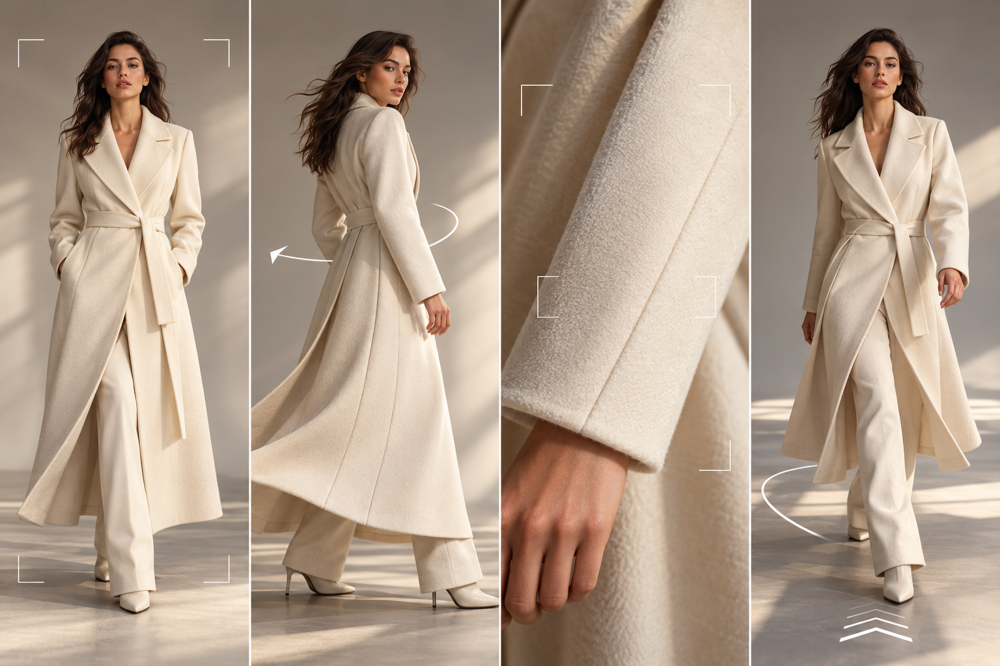

# لوحة القصة وموجّهات فيديو الأزياء بالذكاء الاصطناعي: اجعل الحركة تخدم عرض القطعة

> مقالة مطولة · دليل لوحة قصة الفيديو

## حدّد ما الذي يجب أن يثبته المقطع

لا يحتاج فيديو الأزياء إلى جعل العارضة تدور بلا توقف. قد تحتاج صفحة المنتج إلى إظهار القَصّة والطول، وتحتاج الشبكات الاجتماعية إلى بداية تجذب الانتباه، بينما قد يركز مفهوم الإعلان على الأجواء. اكتب هدفاً واحداً ثم اختر حركة توضحه. لعرض حركة التنورة استخدم دوراناً بطيئاً، وللياقة لقطة ثابتة للجزء العلوي، وللتشويق لمنتج جديد ظهوراً قصيراً للقماش والعارضة. الهدف المحدد يجعل التقييم أسهل.

## لوحة قصة من أربع لقطات لفيديو عمودي قصير

قسّم مقطعاً من 8 إلى 12 ثانية إلى أربع لقطات بسيطة. اللقطة الأولى 1–2 ثانية: وقفة أمامية لكامل الجسم للتعريف بالقطعة. الثانية 2–3 ثوانٍ: لقطة متوسطة أو جانبية للياقة والكتف والخصر. الثالثة 2–3 ثوانٍ: حركة صغيرة واحدة مثل دوران بطيء أو خطوة. الرابعة 1–2 ثانية: عودة إلى لقطة كاملة مستقرة لتأكيد الحاشية والقَصّة. إذا احتوت القطعة تفاصيل كثيرة، اجمع مقاطع قصيرة في المونتاج بدلاً من طلب حركات عديدة في توليد طويل واحد.

## بنية الموجّه: ثبّت القطعة وحدد حركة واحدة والكاميرا

اكتب خمس طبقات: صفات الملابس الثابتة، عارضة بالغة ووضعيتها، حركة رئيسية واحدة، حركة الكاميرا والتأطير، ثم الخلفية والضوء والنسبة والتغييرات الممنوعة. مثال: «حافظ على الأزرار المزدوجة وعرض الياقة وخط الكتف وطول الكم وموضع الجيوب في السترة العنابية المرجعية. تدور عارضة بالغة ببطء مرة واحدة إلى اليسار في استوديو رمادي فاتح. كاميرا ثابتة ولقطة متوسطة وإضاءة جانبية ناعمة وإطار عمودي. لا تضف حلياً ولا تغير اللون أو الأزرار». إذا أخفى المرجع تركيباً مهماً، التقط صورة أخرى؛ صياغة النفي لا توفر دليلاً لم يره النموذج.

## مواءمة اللقطة مع Jimeng وKling وHailuo

تعرض صفحة Jimeng الموجّهات الصينية والتحويل من صورة إلى فيديو وإدخال الإطارين الأول والأخير، وهي خيارات يمكن اختبارها للتحكم في التكوين الافتتاحي والختامي. ويمكن اختبار Kling للحركة وأجواء الكاميرا. ويقترح دليل Hailuo وصف فعل الموضوع والكاميرا والخلفية. تتغير الواجهات والنماذج، فاستخدم المدخلات المتاحة حالياً. لا تعتبر حركة الملابس دليلاً على دقتها.

## تطبيق Visnova: اعتمد الثابت ثم حرّك لقطة واحدة

في [Visnova](https://visnova.ai/) ارفع صورة واضحة مسطحة أو معلقة أو على مانيكان. أنشئ صورة ثابتة للقطعة على العارضة وافحصها، ثم اختر لقطة سهلة من لوحة القصة لتحريكها. أبقِ العارضة والخلفية ثابتتين، وغيّر الحركة أو الكاميرا فقط في كل محاولة. احفظ الموجّهات والإصدارات وافحص البداية والوسط والنهاية وانتقالات الحركة. بعد الاعتماد أضف النص والعلامة في محرر من دون تغطية الياقة أو الخصر أو النقشة.

**الخلاصة:** استخدم الموجّه كلوحة قصة لا كضمان. الحركة القابلة للملاحظة أنفع من كلمات عامة مثل «فاخر» أو «سلس» أو «سينمائي». اختبر افتراضاً واحداً في كل مرة، وحدد عند الفشل هل المشكلة في الصورة أو الحركة أو الكاميرا أو تركيب القطعة. جرّب لقطتك الأولى عبر [Visnova](https://visnova.ai/) أو [موقع Visnova الصيني](https://visnova-ai.cn) وقارنها بالملابس الفعلية.

## المراجع الرسمية

- [Jimeng](https://jimeng.jianying.com/) · [Kling AI](https://app.klingai.com/global/) · [Hailuo image-to-video](https://hailuoai.video/tools/image-to-video)
- [Visnova](https://visnova.ai/) · [Visnova AI Chinese site](https://visnova-ai.cn)
