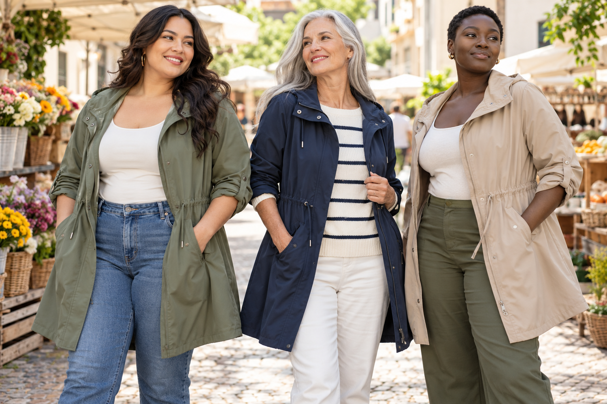

# Mode IA multi-marchés : diversité des corps, faits de taille et confiance

> Article long · contenu multi-marchés

Une image de mannequin peut montrer un style et une situation, mais être prise pour un vrai essayage. Le contenu international doit prendre en compte langue, représentation des corps, conventions vestimentaires, saison et tailles. Traduire le titre ne suffit pas. Le principe consiste à attirer sans transformer le tombé, l’ajustement ou les proportions générés en promesse produit non étayée.

## Diversifier les mannequins pour élargir les choix réels

Selon le public, présentez des mannequins adultes d’âges, tailles, carnations et morphologies variés. Cela évite de limiter les idées de style à un seul idéal. Toutefois, voir un vêtement sur une morphologie ne prouve pas que la taille convient à tout le monde. Faites correspondre l’image à la gamme réelle. Ne transformez pas un petit vêtement en grande taille et n’utilisez pas une taille irréaliste ou des jambes allongées pour promettre une coupe absente. Si la gamme est limitée, images et guide des tailles doivent rester cohérents.

## Localiser ne consiste pas seulement à traduire

Préparez une liste par marché : langue et ton, unités, conversion des tailles, saison, habitudes vestimentaires, format de plateforme, zones de sous-titres et contrôle du stylisme. Conservez le vêtement — col, longueur, couverture, accessoires, imprimé — même lorsque décor, mannequin ou texte changent. Adaptez les couleurs ou les thèmes saisonniers avec contexte ; ne collez pas des symboles culturels au hasard. Faites relire le brief et le stylisme par l’équipe locale avant de produire en lot.

## La transparence crée la confiance

La page produit garde des photos exactes, mesures, composition, conseils d’entretien et notes de coupe. Si une image générée sert d’illustration de style, précisez son rôle si nécessaire. Si elle induit en erreur sur la couleur ou les dimensions, refaites-la : une réserve juridique ne répare pas une représentation fausse. Suivez retours, questions de taille, plaintes sur les images, enregistrements et clics par langue, marché et style. Les vues seules ne suffisent pas : attirer puis provoquer des achats inadaptés n’est pas une bonne localisation.

## Tester plusieurs marchés avec Visnova

Sur [Visnova](https://visnova.ai/), choisissez un article vendu dans plusieurs régions et réunissez les mêmes faits produit avec mannequins, décors et formats adaptés. Créez d’abord une image fixe par marché et validez couleur, longueur, construction et représentation avant un mouvement contrôlé. Inscrivez au SKU le réviseur local, la source des tailles, la version de texte et la date d’accord. La page d’accueil présente un flux mannequin-vêtement ; vérifiez les options disponibles sur le compte actuel.

Nommez les fichiers avec marché/langue, SKU, canal et version pour éviter la réutilisation transfrontalière d’images non revues. Séparez la base produit des variantes locales afin de les actualiser facilement.

**Conclusion :** l’inclusion élargit les options visibles sans exagérer ce que le vêtement peut faire. Appuyez-vous sur le guide réel, sollicitez l’équipe locale et améliorez les visuels grâce aux questions, conversions et retours. Essayez sur [Visnova](https://visnova.ai/) ou [le site chinois de Visnova](https://visnova-ai.cn).
