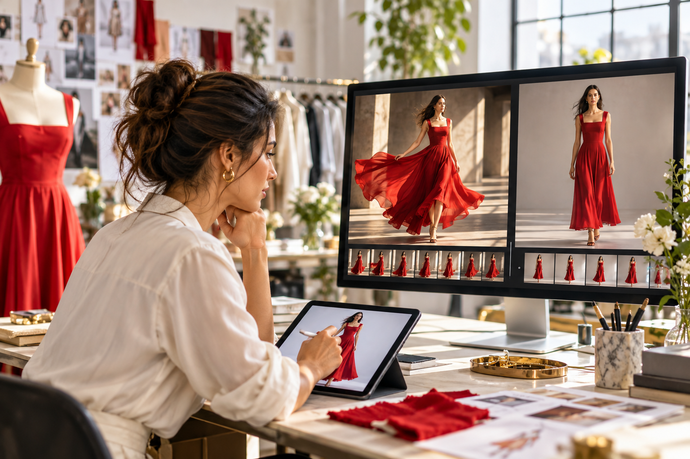

# Создание AI-моды для женщин напрямую в Jimeng, Kling и MiniMax: сравнение и контроль

AI-моду часто описывают так: загрузить фото одежды и получить модельный кадр или короткий модный ролик. Для электронной торговли этого мало: нужно сохранить цвет, крой, принт и конструктивные детали, а процесс сделать повторяемым. В статье Jimeng, Kling и MiniMax Hailuo рассматриваются как универсальные творческие инструменты и сравниваются с ориентированным на одежду процессом Visnova. Описания основаны на открытых страницах и сохранённых скриншотах главных страниц; это не рейтинг качества. Функции, тарифы, региональный доступ и коммерческие права меняются — перед работой проверьте текущие условия своего аккаунта.

## Подготовьте единый тест изделия

Выберите вещь с достоверной карточкой товара. Подготовьте чёткое фото спереди на плоскости или вешалке и детали спинки, ткани, выреза, пуговиц и расположения принта. Зафиксируйте то, что нельзя менять: цвет, воротник, длину рукавов и подола, линию талии, карманы, рисунок и вид материала. Просьба «не менять одежду» в запросе — инструкция, а не техническая гарантия. Используйте в каждом инструменте одинаковые задачу, взрослую модель, движение, формат кадра и фон, чтобы качество исходника не влияло на вывод.

## Jimeng: сначала китайская концепция, затем проверка одежды

В публичном описании Jimeng указаны создание видео из текста или изображения, китайские запросы, начальный и конечный кадры и редактирование на холсте. Сначала определите композицию, свет и сцену на статичном кадре; затем попробуйте доступные в вашем аккаунте начальный/конечный кадры или преобразование изображения в видео. Для карточки товара начните с естественной позы или небольшого поворота. Полное вращение, быстрый шаг и сложный движущийся фон затрудняют поиск дефекта. Сравните число пуговиц, глубину выреза, шаг полос и длину юбки с исходником. При смене фона держите область выделения подальше от края одежды, чтобы не перерисовать силуэт. Текущие возможности смотрите на [официальном сайте Jimeng](https://jimeng.jianying.com/).

## Kling: разделите движение камеры и одежды

На главной странице Kling представлены разделы изображений, видео и творчества; доступные режимы зависят от версии, региона и аккаунта. Возьмите ту же фотографию изделия и начните с малого движения; после проверки добавьте медленный поворот или несколько шагов. Разделите запрос на модель, действие, камеру и среду: «Взрослая модель в платье с референса; поворачивается на четверть влево; неподвижный средний план; простая студия; мягкий боковой свет». При одновременном резком движении камеры и человека трудно определить причину смещения принта. Не утверждайте результат только по превью: экспортируйте достаточное разрешение и проверьте ключевые кадры. Актуальный вход — [Kling AI](https://app.klingai.com/global/).

## MiniMax Hailuo: осторожно оживите утверждённый кадр

Инструкция Hailuo по преобразованию изображения в видео описывает загрузку кадра и текстовое указание движения. В запросе можно отдельно задать действие, камеру, фон и настроение. После проверки статичного изображения попробуйте одно движение: «Сохранить одежду и принт; модель естественно дышит и слегка поворачивается; камера и фон неподвижны». Если при движении подола рисунок расплавляется, талия скачет или манжеты мерцают, сократите ролик, уменьшите амплитуду или разбейте сцену на два плана. Дополнительные прилагательные не всегда устраняют дефект. Уточните загрузку и коммерческие права в своём тарифе. См. [Hailuo image-to-video](https://hailuoai.video/tools/image-to-video).

## Скриншоты главных страниц и честное сравнение

Снимки ниже фиксируют публичные входы и позиционирование на 11 октября 2026 года. Это не результат генерации одной и той же одежды и не доказательство скорости, цены или стабильности. Сделайте минимум три попытки каждым инструментом; два проверяющих используют общий лист: цвет, вырез, манжеты, непрерывность принта, естественность, минуты ретуши, формат экспорта и права. Если меняется признак, по которому покупатель узнаёт изделие, фиксируйте провал, даже если картинка в целом красивая.

### Главная страница Visnova

### Главная страница Jimeng

### Главная страница Kling

### Главная страница MiniMax Hailuo

## Инструкция Visnova: сначала утвердите фото, затем видео

Откройте одежный процесс на [Visnova](https://visnova.ai/) и загрузите чёткое фото на плоскости, вешалке или манекене. Выберите взрослую модель и естественную позу для своей аудитории. Сначала создайте статичный кадр и сравните цвет, вырез, длину рукавов, карманы, принт и подол с фото товара. Только после утверждения добавьте одно спокойное движение и проверьте ключевые кадры. Записывайте SKU, версию исходника, запрос, результат, проверяющего и причину правки. Если каждая вещь требует большой ручной доработки, включите эти минуты в себестоимость и сравните специализированный процесс с универсальным видеоинструментом.

**Итог:** Jimeng, Kling и Hailuo помогают искать сцены и движения, но генерация не гарантирует точность товара. Испытайте кандидатов на одних и тех же изделиях и одновременно оцените точность, человеческий труд, права и стоимость. Подробнее о процессе — на [Visnova](https://visnova.ai/) и [китайском сайте Visnova](https://visnova-ai.cn).

## Официальные страницы

[Jimeng](https://jimeng.jianying.com/) · [Kling AI](https://app.klingai.com/global/) · [MiniMax Hailuo](https://hailuoai.video/tools/image-to-video) · [Visnova](https://visnova.ai/) · [Visnova на китайском](https://visnova-ai.cn)
