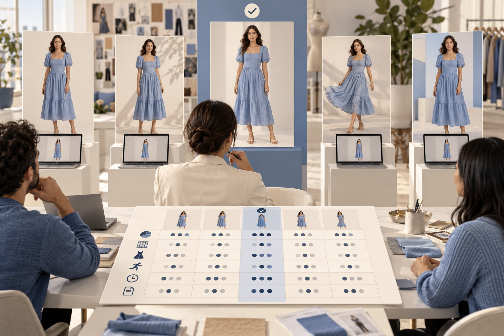

# Ein einwöchiger KI-Mode-Pilot: Werkzeuge anhand von Belegen auswählen

Wenn Teams über KI-Mode sprechen, lautet die erste Frage häufig: „Welches Werkzeug ist das beste?“ Ohne Produktart, Vertriebskanal, Qualitätsgrenze und Kostenbasis kann eine überzeugende Demo das nicht beantworten. Dieser einwöchige Pilot hilft Bekleidungsmarken, E-Commerce-Teams und Content-Studios, Jimeng, Kling, MiniMax Hailuo und Visnova nach einheitlichen Kriterien zu prüfen. Ziel ist nicht ein einzelner spektakulärer Clip, sondern die Erkenntnis, welche SKUs und Aufgaben für generative Abläufe geeignet sind und wo Fotografie oder Handarbeit sinnvoll bleibt. Funktionen ändern sich; dies ist eine wiederverwendbare Bewertungsmethode und kein Leistungsversprechen für eine Plattform.

## Tag 1: Geschäftsziel und aktuelle Vergleichsbasis festlegen

Wählen Sie ein Hauptziel: Produktbilder schneller erstellen, mehr Anzeigenvarianten produzieren oder kurzen Inhalten Bewegung hinzufügen. Ein Pilot sollte nicht alle Einsatzfälle auf einmal beweisen. Wählen Sie 10 bis 20 repräsentative SKUs mit hellen und dunklen Farben, einfarbigen und bedruckten Stoffen, weichen und festen Materialien, leicht verformbaren Röcken und komplexen Oberteilen. Bereiten Sie genehmigte Vorder-, Rück- und Detailaufnahmen vor. Erfassen Sie je Produkt den heutigen Aufwand für Foto, Model, Location, Nachbearbeitung, Wartezeit und Freigabe sowie vorhandene Rückgabe- und Supportdaten. Das ist die Vergleichsbasis.

## Tag 2: Eingaben, Prompts und Bestehenskriterien vereinheitlichen

Erstellen Sie pro Kleidungsstück ein Datenblatt mit Farbe, Material, Schnitt, Details und verbotenen Änderungen. Vereinheitlichen Sie neutralen Hintergrund, eine kleine Bewegung, Seitenverhältnis, Clip-Länge, Ausgabegröße und Referenzbilder. Legen Sie vor dem Erstellen harte Ausschlusskriterien fest: verschobener Druck, fehlendes Ausschnittdetail, erfundene Knöpfe, ein nicht vorhandener Gürtel oder ein Model, das minderjährig wirkt. Vereinbaren Sie die Bewertungsmatrix, bevor Sie Ergebnisse sehen, damit ein schönes Bild nicht die Maßstäbe senkt. Inspirationsbilder erhalten ein eigenes Nutzungsetikett und werden nicht als Produktdetailbilder ausgegeben.

## Tag 3 und 4: Kandidaten mit denselben Produkten testen

Geben Sie Jimeng, Kling, MiniMax Hailuo und dem Bekleidungsworkflow-Kandidaten Visnova dieselben SKUs und dasselbe Briefing. Die Bedienung darf an unterstützte Eingaben angepasst werden, nicht jedoch die Produktfakten und das Bildziel. Erstellen Sie mindestens drei Versuche pro Artikel. Notieren Sie Eingaben, Wartezeit, Fehler, Überarbeitungen, Generierungskosten und die Zahl tatsächlich nutzbarer Assets. Jimeng lässt sich für chinesische Szenenideen und Bildbearbeitung prüfen; Kling und Hailuo für Bewegung aus Standbildern; Visnova anhand des auf der Homepage gezeigten Wegs vom Kleidungsbild zur Modelvisualisierung. Prüfen Sie aktuelle Funktionen, Kontobedingungen und kommerzielle Rechte vor dem Einsatz.

## Tag 5: Produktgenauigkeit und menschlichen Aufwand blind prüfen

Blenden Sie Werkzeugnamen aus und lassen Sie zwei Personen die Ergebnisse mit den SKU-Referenzen vergleichen. Ein Beispielraster vergibt 40 Punkte für Produkttreue, 20 für Bildqualität, 15 für zeitliche Konsistenz, 10 für Retuscheaufwand, 5 für Lieferformat und 10 für Rechte und Datenbedingungen. Diese Pilotgewichtung kann das Team anpassen; sie ist kein Branchenstandard. Ein Fehler bei einem produkterkennenden Merkmal sollte das Ergebnis ausschließen, auch bei hohem Ästhetikwert. Erfassen Sie Retuscheminuten, Neugenerierungen, nutzbare Quote und Übereinstimmung der Prüfenden. Günstige Generierung kann teuer werden, wenn jedes Ergebnis umfangreiche Reparaturen benötigt.

## Tag 6: Tatsächliche Kosten pro freigegebenem Asset berechnen

Berücksichtigen Sie Abo oder Credits, Fehlversuche, manuelle Auswahl, Retusche, Export, Koordination, Rechteprüfung und Vorbereitung der Quelldaten. Eine einfache Kennzahl: sämtliche direkten und Personalkosten des Pilots geteilt durch die Assets, die die Prüfung bestanden haben und wirklich veröffentlicht werden können. Vergleichen Sie diese mit der bisherigen Produktionszeit, Nutzungsquote und dem Wiederverwendungswert. Melden Sie nicht nur den Preis einer Generierung. Ergebnisse ohne kommerzielle Erlaubnis, unterhalb der Qualitätsgrenze oder mit notwendiger Neuproduktion sind keine Einsparung. Bei einer kleinen Stichprobe kennzeichnen Sie das Ergebnis als Tendenz und nicht als sicheren Return on Investment.

## Tag 7: Eine begrenzte Entscheidung treffen und den Ablauf dokumentieren

Entscheiden Sie nach Aufgabe, nicht nach Marke: statisches Produktbild, atmosphärischer Kurzclip oder Modelbilder für eine ganze Kollektion können unterschiedliche Abläufe erfordern. Nur Aufgaben, die Genauigkeit, Rechte und Kosten bestehen, gehen in einen begrenzten Start. Instabile Aufgaben bleiben bei Fotografie oder Handarbeit. Für einen Visnova-Test laden Sie ein geprüftes Flatlay-, Bügel- oder Mannequinbild hoch, wählen ein Model und erstellen zuerst ein Standbild. Vergleichen Sie es mit dem Produktdatenblatt und ergänzen Sie erst nach Freigabe eine einfache Bewegung. Speichern Sie Prompts, SKU, Bildversion, Ausgabe und Prüfentscheidung, damit andere Mitarbeitende den Ablauf wiederholen können.

## Fünf Fragen für den Abschluss

Welche Kleidungsarten bestanden am häufigsten? Welche Details schlugen am häufigsten fehl? Wie viele Arbeitsminuten erforderte ein freigegebenes Asset? Wie liegen die realen Kosten im Vergleich zur bisherigen Fotografie? Haben sich Kundenfeedback, Retouren oder Supportanfragen verändert? Archivieren Sie auch Fehlversuche mit Version, Datum und Einstellungen. Nach einem Modell- oder Produktupdate testen Sie erneut eine feste kleine SKU-Auswahl; ein altes Ergebnis ist keine dauerhafte Garantie.

**Fazit:** Eine gute Werkzeugentscheidung braucht klare Schwellen, gleiche Eingaben, unabhängige Prüfung und vollständige Kosten. Sehen Sie sich den Bekleidungsworkflow bei [Visnova](https://visnova.ai/) oder auf der [chinesischen Visnova-Seite](https://visnova-ai.cn) an und prüfen Sie ihn eine Woche mit Ihrem Sortiment. Der passende Prozess sollte Inhalte verbessern und zugleich das Kleidungsstück zeigen, das Kundinnen tatsächlich kaufen können.

## Offizielle Einstiege

[Visnova AI](https://visnova.ai/) · [Visnova auf Chinesisch](https://visnova-ai.cn) · [Jimeng](https://jimeng.jianying.com/) · [Kling AI](https://app.klingai.com/global/) · [MiniMax Hailuo](https://hailuoai.video/tools/image-to-video)
